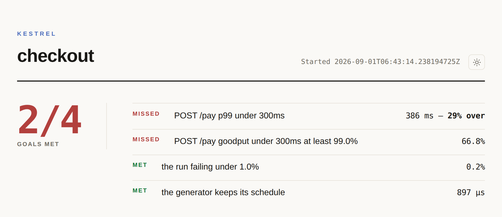

<div align="center">

<picture>
  <source media="(prefers-color-scheme: dark)" srcset="docs/assets/proofload-mark-dark.svg">
  
</picture>

# Proofload

Load testing for the JVM that checks its own schedule.

[](https://github.com/matthewjones372/proofload/actions/workflows/build.yml)
[](https://central.sonatype.com/artifact/io.github.matthewjones372/proofload-core)
<!-- Line coverage, the figure koverVerify's floor is on. `coverage-badge` in
     build.yml rewrites this line, so keep the badge's URL shape. -->
[](https://github.com/matthewjones372/proofload/actions/workflows/build.yml)
[](LICENSE)
[](https://kotlinlang.org)
[](https://adoptium.net)

</div>

A load test is only useful if two things are true: the generator delivered the
load you intended, and the latency it reports is the system's rather than the
generator's. Proofload measures both, and tells you when the first was not
true.

## The problem

Ask a load generator for 200 requests a second and it has to start a request
every 5 ms. When it cannot, because its threads are busy, the machine is
loaded, or it waits for each response before sending the next request, the
requests queue inside the generator.

A generator that times a request from the moment it is finally sent hides that
queue. A request due at 10.000 s that leaves at 10.300 s and gets its answer at
10.310 s is reported as taking 10 ms. A user arriving at 10.000 s would have waited 310 ms. Worse, a
generator that waits for responses sends less while the target is slow, so the
slow period is sampled least. The tail looks healthy, the test passes, and the
target never received the load you asked for.

This is usually called **coordinated omission**, and it fails silently: nothing
in the numbers says it happened.

## What Proofload does

**It schedules every departure in advance.** In an open workload, each user's
start time is computed from the load profile and the user's index. A slow
response does not delay the next user; each user runs on its own virtual
thread.

**It measures each step on two clocks.**

```
                scheduled          actually
                departure          started          answer
                    |------ late ------|--- service ---|
                    |------------ response ------------|
```

*Service time* is what the step took once it started. *Response time* adds how
late the user's departure was, so the delay a user would have felt is not lost.
For a user's first step, that is the whole time from the scheduled departure;
later steps in the journey carry the same departure lateness. Goals read
response time by default.

**It checks its own schedule on every run.** Departure lateness is recorded
for every request, and two checks are computed from it: `fellBehind()`, when
the generator's lateness is large enough to visibly change the reported tail,
and `lostGround()`, when departures were late by more than the planned gap
between them. You can make the first a goal (`keptSchedule`). The report, the
JSON output and the CLI exit code all show the verdict.

So when a run fails, you can tell whether **the target missed its objective**
or **the generator could not sustain the workload**. These checks cover the
generator's departures. They do not prove every number is clean: a virtual
thread stalled in the middle of a step, for example, is counted as the
target's time. [How Proofload measures](docs/measurement.md) sets out exactly
what a run does and does not establish.

## An example

```kotlin
private val orderId = sessionKey<String>("orderId")
private val browse = step("browse")
private val placeOrder = step("place order")

private val api = http.baseUrl("https://orders.internal")

private val checkout = scenario("checkout") {
    exec(browse, api.get("/products"))
    exec(
        placeOrder,
        api.post("/orders")
            .body("""{"cart":"1 anvil"}""")
            .expecting(201)
            .capture(orderId) { it.header("x-order-id") },
    )
}

class CheckoutLoadTest {

    @LoadTest
    fun `checkout holds up at fifty a second`(proofload: Proofload) {
        val result = proofload.run(
            checkout.at(50.perSecond, over = 1.minutes)
                .expecting(p99(placeOrder) under 200.milliseconds, keptSchedule),
        )

        result.writeHtmlReport(Path.of("build/reports/proofload/checkout.html"))

        assertFalse(result.lostGround(), "the generator did not deliver the planned load")
        assertTrue(result.metEveryGoal, result.verdicts.joinToString("\n"))
    }
}
```

This sends 3,000 users over a minute, one every 20 ms, each browsing and then
placing an order. A request with any status but the one it expects fails, with
the status as its reason, and that user's journey stops. The test fails if the
order step's p99 response time is not under 200 ms over the part of the run
after it settled, or if the generator fell behind or lost ground. The complete file, with imports, is in
[Getting started](docs/getting-started.md#a-first-test).

## Reading the result

<div align="center">
<a href="docs/assets/report-full-light.png">
<picture>
  <source media="(prefers-color-scheme: dark)" srcset="docs/assets/report-verdict-dark.png">
  
</picture>
</a>

<sub>The top of a report for a three-step checkout at 30 requests a second.
<code>POST /pay</code> missed its p99 goal by 29%. The generator's p99
departure lateness was 897 µs, so the schedule goal was met: the generator's
lateness is far too small to account for a 386 ms tail.
<a href="docs/assets/report-full-light.png">The whole page</a>.</sub>
</div>

Read a result in this order:

| The run says | It means | What to do |
|---|---|---|
| the generator fell behind or lost ground | response times include time spent queued in the generator, and the load delivered was less than asked for | treat latency goals as unproven; service times still describe the target at the rate that actually left (`result.offered`); re-run at a rate the machine holds, or across [several injectors](docs/more-than-one-injector.md) |
| schedule kept, a goal missed | the target missed its objective at the load it was given | read the step's distribution and failures in the report |
| schedule kept, every goal met | the target met its objectives at that load | check the run sent what you think it did (`result[step].count`) and was long enough for the percentile you quote |

Failed requests are counted by reason (`HttpStatus(503)`, `TimedOut`,
`CheckFailed("has an id")`), not thrown. Percentiles are read from counted
histogram buckets, never interpolated: a step's percentile is at most 0.78%
above the true value.
[Expectations, goals and results](docs/goals-and-results.md) covers the result
in full.

## How a test is written

- **A scenario is a value.** There is no base class to extend and no class
  hierarchy for a framework to discover. A scenario can be built in one file,
  reused in another and inspected before it runs:
  `checkout.at(50.perSecond, over = 1.minutes).userCount()` is `3000` before a
  request is sent.
- **Names are typed values.** `step("place order")` and
  `sessionKey<String>("orderId")` are declared once and used both to build the
  scenario and to read the result, so `result[placeOrder]` cannot refer to a step
  that no longer exists.
- **Expectations belong to the request.** `expecting`, `checking` and `capture`
  are part of the scenario, so a failure has a named reason in the report.
- **Your own code can be a step.** `exec(settle) { ledger.settle(order) }` is
  timed and recorded like any built-in request, so a client you already have can
  be load tested without a plugin.
- **The same scenario runs anywhere.** JUnit, Kotest, zio-test or a plain
  `main`, and from Java or Scala through their own facades.

## What it supports

| | |
|---|---|
| **Protocols** | HTTP and server-sent events, WebSockets, gRPC (with stubs or from a descriptor), Kafka with replies on another topic, JDBC with the connection-pool wait recorded separately, and Pelican clients. [Protocols](docs/protocols.md) |
| **Workloads** | constant, ramped and staged rates, Poisson arrivals, replayed arrival logs, think time, loops, mixes of journeys, closed populations, and runs split across machines. [Workload](docs/workload.md) |
| **Data** | per-user feeders, CSV, generators with a stated cardinality and skew, captures between steps. [Data](docs/data.md) |
| **Other starting points** | YAML plans, a command-line runner, plans generated from OpenAPI documents, and Kotlin generated from HAR recordings. [Plans](docs/plans.md) |
| **Results** | goals and goodput, steady-state detection, capacity search, a self-contained HTML report, GitHub job summaries, baselines and multi-run comparisons, JSON, HdrHistogram, OpenMetrics and OpenTelemetry. [Reports](docs/reports-and-baselines.md), [exporting](docs/exporting.md) |
| **Integrations** | JUnit, Kotest, zio-test, Java, Scala 3, and an MCP server. [Running](docs/running.md), [MCP](docs/mcp.md) |

Each integration is a separate module, so a project takes only the clients it
uses. `proofload-core` depends on nothing but the Kotlin standard library, and
a test in each module checks its classpath. [Modules](docs/modules.md) lists
them all.

## Getting started

Proofload needs JDK 21 or later. `0.1.0-rc4` is the current release, on Maven
Central; the API may still change before `0.1.0` ([versions](docs/versions.md)).

```kotlin
dependencies {
    testImplementation("io.github.matthewjones372:proofload-http:0.1.0-rc4")
    testImplementation("io.github.matthewjones372:proofload-junit5:0.1.0-rc4")
    testImplementation("io.github.matthewjones372:proofload-report-html:0.1.0-rc4")
}
```

[Getting started](docs/getting-started.md) has the complete first test, how to
run it and how to read its report.

## Documentation

**Start here**
- [Getting started](docs/getting-started.md): a first test, run and read.
- [How Proofload measures](docs/measurement.md): the two clocks, the schedule checks, percentiles, and what a result does not establish.

**Writing tests**
- [Running a load test](docs/running.md): JUnit, Kotest, zio-test, a plain `main`, progress output.
- [Shaping the workload](docs/workload.md): rates, ramps, stages, populations, think time.
- [Data per user](docs/data.md): feeders, CSV, generators, captures.
- [Protocols](docs/protocols.md): HTTP, SSE, WebSocket, gRPC, Kafka, JDBC, Pelican, your own client.
- [Expectations, goals and results](docs/goals-and-results.md): checks, goals, failures, capacity search.
- [Plans, OpenAPI and recordings](docs/plans.md): YAML plans, the CLI, OpenAPI, HAR.
- [Java](docs/from-java.md) and [Scala](docs/from-scala.md).

**After the run**
- [Reports, baselines and comparisons](docs/reports-and-baselines.md).
- [Exporting](docs/exporting.md): JSON, HdrHistogram, OpenMetrics, OpenTelemetry.

**Operating it**
- [More than one injector](docs/more-than-one-injector.md).
- [Limiting what a run may do](docs/allowance.md): `proofload.toml`.
- [MCP server](docs/mcp.md).

**Evidence and reference**
- [What a trustworthy result depends on](docs/invariants.md): sixteen properties, which hold, and how they are tested.
- [What Proofload costs](docs/what-it-costs.md): the generator's measured overhead.
- [Modules](docs/modules.md), [versions](docs/versions.md), [cookbook index](docs/cookbook.md), [for agents](docs/for-agents.md), [llms.txt](llms.txt).

**Contributing**: [AGENTS.md](AGENTS.md) describes the spec process, layering
rules and build gates; `./gradlew build` runs them all. [specs/](specs/) holds
the design history.

## Used in

- [tweet-street](https://github.com/matthewjones372/tweet-street): its
  [`lark-bank/loadtest`](https://github.com/matthewjones372/tweet-street/tree/main/lark-bank/loadtest)
  scenarios run in Docker Compose or as a Job in a kind cluster.
- [petshop](https://github.com/matthewjones372/petshop): `./gradlew loadTest`
  starts the service in-process and holds it at 200 requests a second,
  asserting correctness under load as well as latency.
- [starwars-api](https://github.com/matthewjones372/starwars-api), from Scala:
  its [`load-test`](https://github.com/matthewjones372/starwars-api/tree/main/load-test) module.

## License

Apache 2.0. See [LICENSE](LICENSE).
